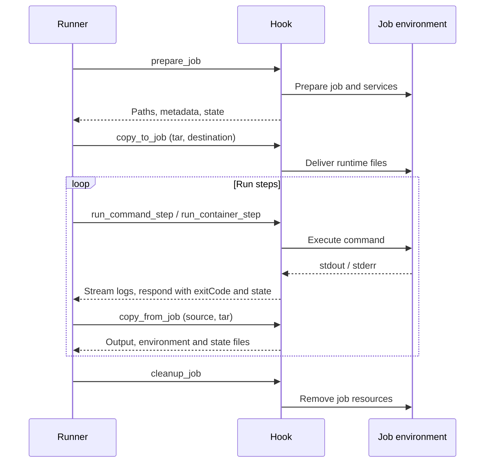

# Container hooks

Container hooks let an operator supply the job runtime and file transport, for example through a
Kubernetes API or a controller. The runner still evaluates workflows, downloads actions, generates
scripts, streams masked logs and processes outputs. A shared filesystem between runner and job is
not required. Protocol v1 supports Linux job environments.

Integrating a new execution API does not require changing the runner's code: implement an adapter in an external hook that uses this protocol and select it in the runner configuration. The same interface covers preparation, command execution, file transfer and cleanup across backends.

## Use cases

- **Nomad:** submit jobs through the [Nomad API](https://developer.hashicorp.com/nomad/api-docs/jobs), letting the scheduler handle placement and resource management.
- **Remote Docker hosts:** select a host from a pool or provision a temporary VM through a cloud API, run job containers through the [Docker API](https://docs.docker.com/engine/daemon/remote-access/), and release the host when the work finishes.
- **Kubernetes with an external controller:** delegate runtime provisioning through a CRD or custom API, for example to a controller modeled on [ARC](https://docs.github.com/en/actions/concepts/runners/actions-runner-controller), with custom scaling, Pod templates, storage and scheduling rules.
- **Job admission policies:** consult an external approval service or policy store in `prepare_job` and reject a job before provisioning its runtime. The hook implements the policy.

## Activation

Add this to the runner configuration:

```yaml
container:
  hooks:
    enabled: true
    entrypoint: /usr/bin/node
    cmd: /opt/container-hooks/index.js
```

`cmd` must be an absolute path to a regular file on the runner. Omit `entrypoint` for a directly
executable program. Validation happens when a job selects hooks. Docker labels and workflow
`container:` jobs use hooks; host jobs and native `kubernetes://` jobs keep their existing runtime.
An enabled hook replaces container execution; failure never falls back to Docker. The runner does
not require a Docker daemon for hook jobs. For local execution, pass the configuration explicitly:
`gitea-runner --config config.yaml exec --image node:24 --no-skip-checkout`.

## How it works

1. `startHookJob` assembles a `HookJob` with the job container, services, workflow context and operator settings. It then creates a `HookEnvironment`, selects it as the job's execution environment and saves the cleanup function for later.
2. `Prepare` invokes the hook with `prepare_job`. The hook prepares the runtime and services, writes paths, metadata and `state` to its response, then exits. The runner reads and validates the response only after the process has exited.
3. The runner sets `RUNNER_*` variables from the returned paths and sends event data and workflow command files through `copy_to_job`. Generated scripts and downloaded action code use the same transport when preparing steps. `actions/checkout` normally clones the project inside the job.
4. Steps run through `run_command_step` or `run_container_step`. Logs stream through the hook's stdout/stderr. The runner uses `copy_from_job` and its existing parsers to read local actions and collect outputs, environment changes and action state.
5. After steps and post actions, the runner calls `cleanup_job` with the last saved `state`. Cleanup also runs after failed or cancelled prepare.



## Details

### Invocation and response

Each operation starts a new local process: `entrypoint cmd`, or `cmd` alone. The runner sends one
UTF-8 JSON object through stdin, then closes stdin. stdout and stderr are streaming job logs,
including workflow commands; they are not the response channel. The hook writes its response to
`responseFile`, closes it and exits. Writing a sibling temporary file and renaming it avoids a
partial response.

```json
{
  "protocolVersion": 1,
  "requestId": "request-123",
  "jobId": "unique-job-id",
  "command": "run_command_step",
  "responseFile": "/runner/private/request-123/response.json",
  "state": {"namespace": "ci", "pod": "job-abc"},
  "args": {
    "entryPoint": "/bin/bash",
    "entryPointArgs": ["--noprofile", "--norc", "-e", "/job/act/workflow/0.sh"],
    "environmentVariables": {"GITHUB_WORKSPACE": "/job/workspace"},
    "workingDirectory": "/job/workspace"
  }
}
```

```json
{
  "protocolVersion": 1,
  "requestId": "request-123",
  "state": {"namespace": "ci", "pod": "job-abc"},
  "result": {"exitCode": 0}
}
```

The response must match the request's version and ID. A missing, malformed or oversized response
fails the operation. Limits are 8 MiB per request, 1 MiB per response and 64 KiB for state. stdin
can span multiple pipe buffers; large file contents belong in the archive transport below.

The process exit code reports whether the hook handled the request. Both execution commands must
return a nonnegative integer `result.exitCode`, including when the user command fails. A hook
process failure is a hook error, not the user's exit code. Successful copy and cleanup return
`"result": {}`. An error response can instead contain
`"error": {"code": "policy_denied", "message": "job was not approved"}`; it fails even if the
process exits zero.
Hook error messages appear in job logs; keep operator-only diagnostics out of them.

`state` is an opaque JSON object, replaced as a whole and sent to subsequent calls. Omitting it
preserves the previous object, `{}` clears it, and `null` is invalid. Valid state is retained even
on a failed command or a structured hook error, so cleanup can find partially created resources.
Calls within one job are sequential. Each matrix combination has its own job ID, state and private
exchange directory; different jobs may call the hook concurrently.

### Operations

| Command | Request `args` | Successful `result` |
| --- | --- | --- |
| `prepare_job` | Job, services, suggested paths, context and operator policy | Runtime paths and metadata below |
| `run_command_step` | Entry point, argv, environment, working directory, optional user | `exitCode` |
| `run_container_step` | Command fields plus image or Dockerfile/build archive | `exitCode` |
| `copy_to_job` | Local `archiveFile`, runtime `destination` directory | `{}` |
| `copy_from_job` | Runtime `source`, local `archiveFile` | `{}` |
| `cleanup_job` | `{}` | `{}` |

`prepare_job` receives `name`, `container`, `services`, `paths`, `context` and `policy`.
Container and service descriptions include `image`, optional `entryPoint` array, `entryPointArgs`,
`environmentVariables`, `volumes`, `ports`, `options` and `registry`. Services are keyed by their
workflow names.

Registry credentials can come from the workflow's `container.credentials` or
`services.<name>.credentials`, including expressions that read repository secrets:

```yaml
container:
  image: registry.example.com/team/job:demo
  credentials:
    username: ${{ secrets.REGISTRY_USERNAME }}
    password: ${{ secrets.REGISTRY_PASSWORD }}
```

The runner evaluates these values and automatically sets variables in the local hook process
environment. The request JSON contains references to those variables:

```json
{
  "registry": {
    "username": {"$env": "GITEA_CONTAINER_HOOK_SECRET_JOB_USERNAME"},
    "password": {"$env": "GITEA_CONTAINER_HOOK_SECRET_JOB_PASSWORD"}
  }
}
```

The hook reads each referenced variable, for example
`process.env[args.container.registry.password.$env]` in Node.js. Operators do not need to set
these variables manually: their values come from the workflow. Registry credential values are
carried in the hook's environment rather than the request JSON.

The Kubernetes demo currently rejects workflow registry credentials and uses pre-created
`imagePullSecrets` configured through `GITEA_HOOK_IMAGE_PULL_SECRETS`. This is a demo limitation;
the protocol already delivers workflow credentials to the hook.

Context contains repository, ref, SHA, actor, event name, run ID, job key and workflow name.
Operator policy is separate from workflow container fields: `privileged`, `usernsMode`, `network`,
`options`, `validVolumes`, `volumes`, `capAdd`, `capDrop`, `platform`, `forcePull`, `forceRebuild`.
The hook enforces these settings or rejects unsupported requests. Workflow options and volume
requests are untrusted. A protected-runner policy can deny `prepare_job` in the hook, without a
policy engine inside the runner. Successful prepare means the runtime and requested services
are ready, not merely submitted to a controller.

```json
{
  "paths": {
    "workspace": "/job/workspace",
    "act": "/job/act",
    "temp": "/job/tmp",
    "toolCache": "/opt/hostedtoolcache"
  },
  "runner": {"os": "Linux", "arch": "X64"},
  "imageEnvironment": {"PATH": "/usr/local/bin:/usr/bin:/bin"},
  "container": {"id": "job-abc/job", "network": "job-abc"},
  "services": {"database": {"id": "job-abc/database", "ports": {"5432": "5432"}}}
}
```

This is the prepare `result`, inside the response envelope. All four paths must be absolute Linux
paths, and remain stable until cleanup. The runner translates paths relative to its workspace to
the returned job workspace, and constructs action and file-command paths under `act`. Container
and requested service IDs must be nonempty; ports populate `job.services.<name>.ports`. Return the
job image's environment, especially PATH. The backend must make those values available to commands
in the job environment. The runner supplies workflow environment and file-command paths on each
execution, which take precedence over image defaults.

`run_command_step` serves the runner's `Exec` operations, including shell steps, JavaScript/Go
actions and internal probes. It may occur more than once per YAML step. Execute the given argv
without joining it into a shell string. Honour `user` if supplied, or fail explicitly.

`run_container_step` serves `docker://` steps and Docker actions, including their pre/post stages.
An empty `entryPoint` leaves the image's default entrypoint in effect. For Dockerfile actions the
request supplies `dockerfile` relative to a tar build root, `buildContextArchive` on the runner,
and optional `buildArgs`. The hook builds and runs the image, or reports an unsupported-operation
error; the runner never builds it through Docker. Apply `.dockerignore` during building. These
containers must see the job's workspace, action files, file-command paths and service network,
and their filesystem changes must be available to later steps.

## File transport

`archiveFile` always names a local, private file accessible to the runner and hook process. It is
not a path inside the remote job. The runner closes an input archive before invoking the hook,
and removes it after the call. For `copy_from_job`, the hook writes and closes the archive before
returning success; the runner removes it after reading. Do not send binary archives through hook
stdout, which is reserved for logs. The hook chooses its transport, for example tar over a
Kubernetes exec session or object storage.

For `copy_to_job`, extract the tar entries relative to `destination`, creating parent directories
and overwriting only the supplied entries. Preserve file modes and symlinks; prevent absolute,
`..` or symlink paths from escaping the extraction directory. This operation is not a workspace
mirror and must not delete unrelated files.

For `copy_from_job`, a file source produces an archive whose first entry is that file (with its
basename). A directory source includes that directory; a source ending in `/.` includes its
contents relative to the archive root. This last form supplies build contexts for local Docker
actions. Return `error.code: "not_found"` only for an absent source. Any other transfer error
must fail, rather than silently dropping outputs or environment changes.

Normally checkout clones the project inside the job. The runner sends the checkout action's own
code, generated scripts, event data and file-command files through `copy_to_job`. A local action
manifest is read with `copy_from_job`; its implementation is already in the job workspace.
Outputs, environment, PATH and action state use the existing runner parsers after execution,
including a nonzero step exit. Post actions finish before cleanup. The local `exec` checkout
shortcut can instead send an existing host checkout through the same copy operation.

## Cleanup and compatibility

Cleanup also runs after failed or cancelled prepare, with an independent bounded context and the
last valid state. It must be idempotent and able to find resources by `jobId` if the prepare response
was lost. Cancellation terminates the local hook process tree; the backend must terminate remote
execution and clean up resources. A controller or backend TTL handles runner crashes, when no
cleanup call can be guaranteed. Operations are not retried automatically.

Hooks are trusted operator programs, running with the runner's privileges. They inherit its
environment. Request environment, state and archives may contain secrets; keep them private and
never dump them into logs. The runner masks normal job output but cannot protect arbitrary files
or external systems written by the hook. Cache/artifact endpoints must be reachable from the job;
the runner does not attach hook workloads to Docker networks to reach them.

## GitHub compatibility

This is inspired by GitHub container hooks, not wire-compatible with them: `run_command_step`
replaces `run_script_step`, file transport has two explicit operations, and responses carry an
exit code and protocol envelope. Existing GitHub Kubernetes hooks need an adapter for dispatch,
paths, state, copy operations and per-job resource naming. The built-in Kubernetes runtime is
independent of this interface. The Python hook under `act/runner/testdata/container-hooks` is a
local protocol test fixture; it runs commands on the test host and does not create containers.

## Example

For an executable Node.js backend and a kind walkthrough, see the
[Container hooks (Kubernetes API demo)](../examples/container-hooks/demo/k8s).
